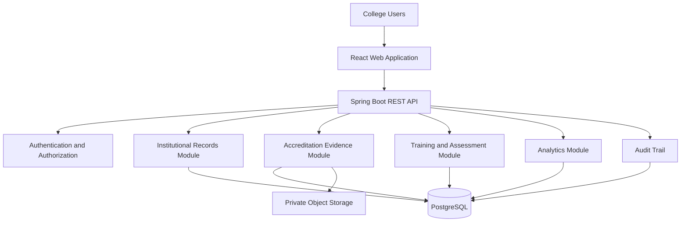

# CollegeOps + IndustryReady
## Multi-Agent Autonomous Development Specification

**Project type:** B2B SaaS for colleges and universities  
**Initial market:** Engineering colleges in India  
**Development model:** Two collaborating coding agents  
**Initial team:** Solo founder + two AI coding agents  
**Backend:** Java 21+ and Spring Boot  
**Frontend:** React + TypeScript  
**Database:** PostgreSQL  
**Architecture:** Modular monolith with REST APIs

---

# 1. Mission

Build a production-minded, multi-tenant college intelligence platform that combines:

1. Institutional digital records and document management.
2. Accreditation evidence tracking and reporting support.
3. Industry-aligned student training and skill assessments.
4. Institutional dashboards for academic quality, skill gaps and training outcomes.

The platform is sold to colleges as a B2B institutional subscription. College administrators, principals, IQAC coordinators, faculty members and training and placement officers are the primary institutional users. Students use the training and assessment features provisioned by their institutions.

The goal is not to create a collection of disconnected dashboards. Build one integrated system with shared institutional identity, permissions, data contracts and reporting.

**Primary principle:** Build working, tested and integrated software. Do not stop after producing plans, mockups, placeholder pages or documentation.

# 2. Product Requirements

## 2.1 Institutional Records

Implement:

- Institution and department management.
- Academic programs and courses.
- Faculty and student profiles.
- Academic-year and semester organization.
- Document uploads with metadata and version history.
- Search and filtering.
- Record ownership and review status.
- Secure document access.
- Audit trails for important changes.
- Import and export capabilities where appropriate.

## 2.2 Accreditation Evidence Management

Create a configurable evidence management system supporting applicable institutional and program-level workflows.

Required capabilities:

- Evidence criteria and requirement categories.
- Framework, version, academic year and department association.
- Evidence submission and document attachment.
- Status tracking: NOT_STARTED, IN_PROGRESS, SUBMITTED, NEEDS_REVISION and VERIFIED.
- Reviewer comments and revision history.
- Missing-evidence reports.
- Assigned owners and due dates.
- Evidence completeness dashboards.
- PDF and CSV report generation.
- Source references and traceability for configured criteria.

Support configurable mappings for NBA, NAAC, AICTE-related documentation and NIRF data collection where applicable.

Do not hard-code regulatory requirements as permanently valid. Framework definitions must be versioned and maintainable.

Do not claim that document completeness guarantees accreditation, approval or ranking.

## 2.3 Industry Readiness and Training

Implement an initial Java/Spring Boot developer pathway.

Suggested skill sequence:

1. Java fundamentals and object-oriented programming.
2. Collections, exception handling and clean coding.
3. SQL and relational database fundamentals.
4. REST API design.
5. Spring Boot and dependency injection.
6. Persistence with Spring Data JPA.
7. Authentication and API security fundamentals.
8. Testing and debugging.
9. Git, GitHub and basic CI.
10. Practical project implementation.

The pathway must be configurable. It is not an official hiring curriculum for any company unless validated by that company.

Required features:

- Job-role and skill catalog.
- Role-specific skill requirements.
- Training pathways and modules.
- Student enrollment in institution-managed cohorts.
- Assignments and practical projects.
- Assessments with explicit rubrics.
- Assessment results and skill-level tracking.
- Baseline versus final assessment comparisons.
- Cohort-level performance reports.
- Trainer feedback and progress tracking.
- CSV exports for placement teams.

Use actual employer-provided job requirements only when authorized. Otherwise, label skill frameworks as internally defined or based on publicly available job descriptions.

Do not guarantee employment or infer that course completion alone proves job readiness.

## 2.4 Institutional Intelligence Dashboard

Provide role-appropriate dashboards showing:

- Institutional record completeness.
- Evidence pending review.
- Missing documents and overdue actions.
- Training participation and completion.
- Skill assessment distributions.
- Skill gaps by cohort and job role.
- Assessment improvement.
- Exportable institutional reports.

Keep metrics transparent. Every metric must have a defined calculation and source data.

# 3. Agent Organization

Two agents work in parallel under this specification.

## Agent 1 — Platform and Institutional Intelligence Lead

**Primary responsibility:** Build the shared platform foundation and the institutional records and accreditation modules.

### Ownership

- Repository structure and application bootstrap.
- Shared frontend shell and navigation.
- Authentication and role-based authorization.
- Institution and department management.
- Shared database conventions and migration strategy.
- Institutional records.
- Document metadata and secure storage integration.
- Accreditation criteria and evidence workflows.
- Evidence review, version history and audit trails.
- Institutional dashboard foundation.
- Shared API error handling.
- Docker-based local development.
- Integration coordination and final system verification.

### Required outputs

- Working Spring Boot application.
- Working React application shell.
- Database migrations for shared and institutional entities.
- Institution-scoped authorization.
- Records and evidence APIs.
- Records and evidence interfaces.
- API documentation.
- Automated tests.
- `docs/agent-1-status.md`.

Agent 1 must establish the shared contracts before Agent 2 builds dependent functionality.

## Agent 2 — Industry Readiness and Training Lead

**Primary responsibility:** Build the training, assessments, skill-gap analytics and industry-readiness module.

### Ownership

- Skill catalog and job-role mapping.
- Training pathways and modules.
- Cohorts and student enrollments.
- Assessments and rubrics.
- Assignment and project tracking.
- Assessment results and progress analytics.
- Training dashboard and student-facing interfaces.
- Trainer feedback workflows.
- Cohort-level skill-gap reports.
- Training-related API tests.
- `docs/agent-2-status.md`.

### Required outputs

- Working training module integrated into the shared application.
- Database migrations for training entities.
- Backend services and REST endpoints.
- React interfaces for students, trainers and placement officers.
- Sample training pathway and assessment data.
- Automated tests.
- API documentation.
- Integration notes and known limitations.

Agent 2 must use the agreed shared authentication, institution and user models. Do not create a second authentication system or a separate institution database.

# 4. Shared Architecture Contract

The two agents must agree on these conventions before implementing cross-module dependencies.

## Backend

- Java 21 or a newer compatible LTS release.
- Spring Boot 3.x or a compatible stable release.
- Maven.
- Spring Web.
- Spring Security.
- Spring Data JPA.
- Jakarta Bean Validation.
- PostgreSQL.
- Flyway database migrations.
- Spring Boot Actuator.
- OpenAPI documentation.
- JUnit 5 and Spring Boot testing support.

Select compatible dependency versions and document the exact versions in the build files.

Use a modular monolith, not microservices.

Suggested package structure:

    com.collegeops
      config/
      security/
      common/
      institution/
      users/
      records/
      documents/
      accreditation/
      training/
      assessment/
      analytics/
      reporting/

Each module should separate its API controllers, services, repositories, entities and DTOs where appropriate.

Business logic must reside in services, not controllers.

Do not expose JPA entities directly as public API responses.

## Frontend

- React.
- TypeScript with strict type checking.
- Vite.
- React Router.
- A consistent component and styling system.
- A centralized API client.
- Typed request and response models.
- Reusable form, table, dialog, loading, error and empty states.

Use a consistent application layout and navigation structure.

Do not build duplicate navigation shells or competing design systems.

## Database and tenancy

Use a shared PostgreSQL database with institution-scoped records.

Every institution-owned record must be associated with its institution directly or through an enforceable parent relationship.

Enforce tenant isolation in the backend. Never rely on frontend filtering alone.

Use UUIDs or another consistent identifier strategy. Use explicit foreign keys, indexes, uniqueness constraints and timestamps.

Store uploaded files in object storage or a suitable local development adapter. Store file metadata and storage keys in PostgreSQL rather than placing large document contents directly into database rows.

Never commit credentials, API keys or real student data.

# 5. Shared API Contract

Use `/api/v1` as the API prefix.

Expected endpoint families include:

    /api/v1/auth
    /api/v1/institutions
    /api/v1/departments
    /api/v1/users
    /api/v1/students
    /api/v1/faculty
    /api/v1/documents
    /api/v1/accreditation/frameworks
    /api/v1/accreditation/criteria
    /api/v1/accreditation/evidence
    /api/v1/training/skills
    /api/v1/training/job-roles
    /api/v1/training/pathways
    /api/v1/training/cohorts
    /api/v1/training/enrollments
    /api/v1/training/assessments
    /api/v1/training/results
    /api/v1/analytics

These are planned endpoint families, not permission to implement incompatible schemas independently.

Before Agent 2 implements endpoints, Agent 1 must publish the agreed models for:

- Institution.
- User.
- Role and permissions.
- Student.
- Department.
- Academic program.
- Audit metadata.
- Standard API errors.

Use DTOs and validation. Apply pagination and sorting to collection endpoints.

Use a consistent error response containing an error code, human-readable message and relevant validation details.

Document authentication requirements and authorization rules for each endpoint.

# 6. Agent Communication Protocol

The repository is the shared source of truth. Neither agent should depend on undocumented chat history or assume that the other agent knows about uncommitted changes.

Create these files:

    docs/
      architecture.md
      api-contracts.md
      database-design.md
      integration-plan.md
      agent-1-status.md
      agent-2-status.md
      decisions.md
      test-plan.md
      known-issues.md

## Before starting a task

Each agent must:

1. Read this README.
2. Read the architecture and API contracts.
3. Read both agent status files.
4. Inspect the current codebase and Git status.
5. Check existing migrations, endpoints and tests.
6. Identify dependencies and file ownership.
7. Record the task and expected deliverables.

Do not overwrite another agent's work or recreate an existing module without first inspecting it.

## After completing a task

Update the relevant status file with:

- Task and owner.
- Current status: NOT_STARTED, IN_PROGRESS, BLOCKED, READY_FOR_INTEGRATION or DONE.
- Files created or changed.
- API or schema changes.
- Tests executed and their results.
- Decisions made.
- Outstanding issues.
- Dependencies for the other agent.
- Exact next action.

Use ISO 8601 timestamps with timezone where practical.

## Change communication

When an agent changes a shared contract, it must:

1. Explain the reason for the change in `docs/decisions.md`.
2. Update `docs/api-contracts.md` and relevant architecture documentation.
3. Notify the other agent through the available shared task or communication mechanism.
4. Identify required changes to dependent code.
5. Avoid marking the work complete until dependent changes are addressed.

If the execution environment does not provide direct agent-to-agent messaging, use the shared status files and Git pull requests as the communication channel.

Do not claim to have notified another agent unless an actual notification was sent.

# 7. Git and File Ownership Rules

Use one repository and a shared integration branch.

Recommended branches:

    main
    integration
    agent-1/institutional-platform
    agent-2/industry-readiness

`main` must remain deployable. Use pull requests or an equivalent review process to integrate completed work.

Agent 1 owns the application bootstrap, shared contracts, security configuration and shared frontend shell.

Agent 2 owns the training domain and its dedicated UI components.

Both agents must coordinate before modifying shared configuration, security, database migration ordering, global styles, navigation or common DTOs.

Do not have both agents independently modify the same file.

Each agent must:

1. Inspect the latest integration branch.
2. Create or update its assigned branch.
3. Make small, coherent commits.
4. Run tests and build checks.
5. Update its status file.
6. Open or prepare a reviewable change.
7. Resolve conflicts without discarding another agent's work.
8. Re-run relevant tests after integration.

Never use destructive Git commands to erase another agent's work. Never force-push shared branches without explicit authorization.

# 8. Execution Phases

## Phase 0 — Repository Discovery and Design

Both agents inspect the repository and existing implementation.

Agent 1 defines the architecture, common data model, security conventions and application bootstrap.

Agent 2 reviews the proposed training data model, identifies dependencies and proposes the module's API requirements.

**Exit criteria:**

- Architecture documented.
- File ownership established.
- Shared entity and API contracts agreed.
- Initial database migration strategy documented.
- Both agents acknowledge dependencies.

Do not spend excessive time producing design documents. Once contracts are sufficiently clear, proceed to implementation.

## Phase 1 — Runnable Foundation

Agent 1 builds the application bootstrap, database connectivity, migrations, shared UI, authentication and role-based access.

Agent 2 builds against the agreed contracts and prepares the training module's schema, services and tests without independently redefining shared models.

**Exit criteria:**

- Backend starts successfully.
- Frontend starts successfully.
- Database migrations run from a clean database.
- Authentication and authorization have automated tests.
- Local development instructions work.

## Phase 2 — Parallel Module Implementation

Agent 1 implements institutional records, document management, evidence workflows and reporting.

Agent 2 implements skills, pathways, cohorts, assessments, results and training analytics.

Both agents maintain their own tests and update status files.

**Exit criteria:**

- Each module works independently against the shared contracts.
- APIs are documented.
- Validation and error handling are implemented.
- No module relies on mock responses for core functionality.
- Tests pass for the implemented features.

## Phase 3 — Integration

Connect the modules through shared identity and institution context.

Implement:

- Shared navigation.
- Role-aware access.
- Cross-module dashboards.
- Consistent API errors and loading states.
- Institution-scoped analytics.
- Integrated document and report workflows.

**Exit criteria:**

- A user can sign in and access authorized modules.
- Institutional records and training results appear in the correct institution's dashboards.
- Unauthorized cross-institution access is rejected.
- A clean installation runs using the documented procedure.

## Phase 4 — End-to-End Verification

Run the complete test plan against a clean environment.

Test both successful and failure scenarios.

Fix integration defects before expanding the feature set.

**Exit criteria:**

- Backend and frontend production builds succeed.
- Database migrations work from scratch.
- Critical API integration tests pass.
- Critical end-to-end user journeys pass.
- No known critical security issues remain unresolved.
- Setup and deployment documentation is accurate.

## Phase 5 — Pilot Readiness

Prepare:

- Synthetic demo data.
- A sample accreditation evidence workflow.
- A Java/Spring Boot training pathway.
- An institution management dashboard.
- A student skill-gap report.
- A short pilot onboarding guide.
- A documented list of current limitations.

Do not use fabricated customer testimonials, fake placement outcomes or unverified compliance claims.

# 9. Definition of Done

A feature is not complete merely because code has been generated.

Every feature must satisfy all applicable conditions:

- Implements the stated acceptance criteria.
- Follows the agreed architecture.
- Includes server-side validation.
- Enforces authentication and authorization.
- Enforces institution-level access boundaries.
- Handles errors and empty states.
- Includes appropriate automated tests.
- Uses database migrations for schema changes.
- Includes relevant API documentation.
- Has been built and tested in the actual project environment.
- Does not break existing functionality.
- Is documented in the agent status file.

If a feature cannot be completed, mark it BLOCKED and record the exact blocker and next action. Never mark an untested feature as DONE.

# 10. Security and Data Integrity

Implement security from the beginning.

Requirements:

- Role-based authorization enforced by the backend.
- Institution-level tenant isolation.
- Secure password hashing if local authentication is implemented.
- Safe session or token handling.
- Input validation and parameterized database access.
- File size and type restrictions.
- Secure file access and storage keys.
- Audit logs for sensitive record changes.
- Secrets managed through environment variables or a secret manager.
- No real student data in development fixtures.
- Backup and restoration instructions.
- Appropriate retention and deletion policies.
- Protection against insecure direct object references.

Use synthetic data for demonstrations and tests.

Avoid storing unnecessary personal information. Document how student data is collected, accessed, retained and deleted.

# 11. Testing Strategy

Include:

1. Unit tests for business logic.
2. Repository and database integration tests.
3. API tests for success and failure cases.
4. Authorization tests for each important role.
5. Tenant-isolation tests.
6. File access and upload validation tests.
7. Frontend component and form tests.
8. Cross-module integration tests.
9. Critical end-to-end workflows.
10. Clean installation and production build checks.

Minimum critical journeys:

**Journey A — Institutional evidence**

An authorized faculty member submits evidence, an authorized reviewer reviews it, a revision is requested if necessary, and the final verified status appears in the institutional dashboard.

**Journey B — Student training**

A placement officer creates a training cohort, enrolls authorized students, students complete assessments, trainers review project submissions, and the dashboard shows the results.

**Journey C — Skill-gap analysis**

A placement officer selects a job role, the platform compares its defined skill requirements against student assessment results, and the platform displays transparent cohort-level gaps.

**Journey D — Security isolation**

A user from Institution A attempts to access Institution B's student, document, assessment or evidence records. The request must be denied without exposing the other institution's data.

# 12. Definition of the First Release

The first release must provide a coherent, integrated workflow rather than maximum feature count.

Release scope:

- Institution and department setup.
- User roles and authorization.
- Faculty and student records.
- Document upload and metadata.
- Configurable evidence criteria.
- Evidence review and completeness reporting.
- One Java/Spring Boot training pathway.
- Cohort management.
- Practical assessments and results.
- Skill-gap analytics.
- PDF/CSV exports.
- Audit history.
- Setup documentation and synthetic demo data.

Defer complex AI features until the underlying data is reliable.

If AI-assisted document extraction is added later, extracted fields must retain their source references and be reviewed before becoming verified institutional records.

# 13. Final Instructions to Both Agents

You are responsible for delivering working software, not merely describing a solution.

Start by inspecting the repository. Preserve useful existing code. Identify the current implementation status before making changes.

Work in your assigned domain, follow shared contracts, communicate changes through repository artifacts, and test every meaningful feature.

Prioritize correctness, security, maintainability and integration over unnecessary complexity.

Do not invent API results, claim tests passed when they were not run, or silently ignore blockers.

When one module depends on the other, document the dependency and coordinate using the shared communication protocol.

At the end of each task, report:

1. What was implemented.
2. Which files changed.
3. Which tests ran and their actual results.
4. Whether the changes are integrated.
5. What remains incomplete.
6. The next concrete action.

**Final objective:** Deliver a runnable, secure, tested and integrated B2B college platform that can be demonstrated to a pilot institution and extended without rewriting its architecture.

Begin with Phase 0, then continue through the phases until all acceptance criteria are met. Do not stop at planning when implementation is possible.


# CollegeOps + IndustryReady
## System Design Specification and Edge-Case Handling Requirements

**Document type:** Engineering specification  
**Architecture:** Modular monolith  
**Backend:** Java 21+ · Spring Boot 3.x · Spring Security · Spring Data JPA  
**Frontend:** React · TypeScript · Vite  
**Database:** PostgreSQL · Flyway migrations  
**API style:** REST · JSON · `/api/v1`  
**Development model:** Two cooperating coding agents sharing one repository

---

# PART A — SYSTEM DESIGN INSTRUCTIONS

## 1. Product Objective

Build a multi-tenant B2B SaaS platform for colleges that connects institutional operations with industry-aligned student skill development.

The platform must help colleges:

1. Maintain structured institutional records, faculty information, student information, and supporting documents.
2. Organize accreditation evidence and map it to configurable frameworks, criteria, and metrics.
3. Track evidence ownership, review, approval, expiry, and audit history.
4. Deliver industry-oriented training pathways, assessments, and skill evaluations.
5. Measure student readiness for specific job roles using transparent, explainable metrics.
6. Provide dashboards for management, IQAC, faculty, placement teams, trainers, and students.

**Core product principle:** Institutional records and student readiness are related but separate domains. Connect them through controlled integration, not by coupling every feature into one large module.

## 2. Mandatory Engineering Rules

Both agents must follow these rules.

- Inspect the existing repository before creating or modifying files.
- Preserve working functionality. Do not replace existing implementations without a documented reason.
- Implement functional software, not placeholder endpoints, mock success responses, or hardcoded dashboards.
- Follow the agreed architecture, database schema, API contracts, and authorization rules.
- Keep business logic out of controllers and UI components.
- Use DTOs for API requests and responses. Never expose persistence entities directly.
- Validate inputs at API boundaries and enforce critical invariants in the service and database layers.
- Use database migrations for every schema change.
- Use transactions for operations that must succeed or fail as a unit.
- Add automated tests for normal behavior, permissions, validation, and relevant failure scenarios.
- Never silently swallow exceptions or report success when an operation failed.
- Never commit credentials, access tokens, private student data, or production data.
- Do not introduce new infrastructure or dependencies without a clear need.
- Do not claim that a feature is complete until its tests and integration checks pass.

## 3. System Architecture

Use a **modular monolith** for the initial release. Deploy the backend as one application while maintaining clear domain boundaries. Do not introduce microservices, Kafka, Kubernetes, or distributed transactions unless a documented requirement justifies them.

### High-level architecture



### Architectural layers

**Frontend**
- Pages and route handling.
- Reusable UI components.
- Typed API client.
- Authentication state and permission-aware navigation.
- Form validation and clear loading, empty, success, and error states.
- Dashboard visualizations based on actual API data.

**Controller layer**
- Expose REST endpoints.
- Parse and validate requests.
- Apply authentication requirements.
- Delegate work to application services.
- Return consistent HTTP responses.

**Application/service layer**
- Enforce business rules and authorization at the operation level.
- Coordinate transactions.
- Manage workflows and state transitions.
- Call repositories and external adapters.
- Publish audit events for auditable actions.

**Persistence layer**
- Spring Data JPA repositories.
- PostgreSQL entities and relationships.
- Explicit transaction boundaries.
- Database constraints and indexes.
- Flyway-managed schema changes.

**Infrastructure/adapters**
- File storage.
- Email notifications, if enabled.
- Background jobs, if required.
- External AI/document-processing providers, if introduced later.

## 4. Domain Modules and Ownership

### Module A — Institutional Platform

Owned by **Agent 1**.

Responsibilities:

- Institution and department management.
- User and role administration.
- Student and faculty records.
- Institutional document management.
- Accreditation framework configuration.
- Criteria and metric mapping.
- Evidence submission, review, approval, rejection, and expiry.
- Audit history.
- Institutional reporting and APIs consumed by other modules.

Suggested package structure:

```text
institutional/
  institution/
  department/
  user/
  student/
  faculty/
  document/
  accreditation/
  evidence/
  audit/
```

### Module B — Industry Readiness

Owned by **Agent 2**.

Responsibilities:

- Skills and skill categories.
- Job roles and required skill levels.
- Training pathways and learning resources.
- Cohorts and enrollment.
- Assessments, attempts, scoring, and results.
- Student skill profiles.
- Readiness calculations.
- Placement and employability analytics.
- Training-related frontend pages and API client integration.

Suggested package structure:

```text
readiness/
  skill/
  jobrole/
  pathway/
  cohort/
  enrollment/
  assessment/
  result/
  readiness/
  analytics/
```

### Shared responsibilities

Both agents must coordinate on:

- Authentication and authorization.
- Institution and department identifiers.
- Student identity and enrollment references.
- Common API response and error formats.
- Audit conventions.
- Database migration naming and ordering.
- Frontend routing and shared components.
- Integration tests and release readiness.

**Ownership rule:** Only one agent should modify a shared file at a time. Agent 1 owns shared backend foundation files unless both agents explicitly agree on a different owner. Agent 2 must not create duplicate user, institution, or student entities.

## 5. User Roles and Authorization

Implement role-based access control with institution-level data isolation.

| Role | Typical permissions |
|---|---|
| SaaS platform administrator | Platform operations and tenant administration |
| College administrator | Manage their institution, departments, and authorized users |
| IQAC/accreditation officer | Manage evidence and accreditation workflows |
| Faculty | Access assigned academic records and authorized evidence |
| Placement officer | View permitted student readiness and placement information |
| Trainer | Manage assigned cohorts, learning activities, and assessments |
| Student | Access their own training, assessments, results, and profile |

Treat these as initial roles. Permission granularity should be configurable without scattering hardcoded role checks throughout the codebase.

Use permissions such as:

```text
institution:read
institution:manage
student:read
student:manage
evidence:submit
evidence:review
evidence:approve
training:manage
assessment:grade
results:read
analytics:read
```

Every protected operation must verify:

1. The caller is authenticated.
2. The caller has the required permission.
3. The requested resource belongs to the caller's authorized institution or permitted scope.
4. Any workflow-specific restriction is satisfied.

Frontend permission checks improve usability but **never replace backend authorization**.

## 6. Multi-Tenant Data Model

Every tenant-owned record must be associated with an institution, directly or through an explicitly documented parent relationship.

Core entities:

```text
Institution
 ├── Department
 ├── User
 ├── Student
 ├── Faculty
 ├── InstitutionalDocument
 ├── AccreditationFramework
 │    └── AccreditationCriterion
 │         └── EvidenceRecord
 ├── Skill
 ├── JobRole
 ├── TrainingPathway
 ├── Cohort
 │    └── Enrollment
 └── Assessment
      ├── AssessmentAttempt
      └── AssessmentResult
```

Additional supporting entities may include audit events, evidence versions, review records, skill requirements, and notification records.

### Database requirements

- Use UUIDs or another consistently selected identifier strategy.
- Use foreign keys for relational integrity.
- Use unique constraints for tenant-scoped business identifiers.
- Use `NOT NULL` where the domain requires a value.
- Store timestamps consistently, preferably as UTC instants.
- Use optimistic locking (`@Version`) for records that may be edited concurrently.
- Add indexes for common filters, tenant scoping, joins, and dashboard queries.
- Define deletion and retention behavior for every major entity.
- Avoid cascading deletes for critical evidence, audit records, assessment history, and student records unless explicitly justified.
- Store large files in private object storage; keep file metadata and storage keys in PostgreSQL.

Never rely exclusively on a client-provided `institutionId` to establish authorization. Derive the authorized tenant scope from the authenticated principal and validate it against the requested resource.

## 7. API Design

All endpoints must use `/api/v1`.

Example endpoint groups:

```text
/api/v1/auth
/api/v1/institutions
/api/v1/departments
/api/v1/users
/api/v1/students
/api/v1/faculty
/api/v1/documents
/api/v1/accreditation/frameworks
/api/v1/accreditation/criteria
/api/v1/evidence
/api/v1/skills
/api/v1/job-roles
/api/v1/training-pathways
/api/v1/cohorts
/api/v1/enrollments
/api/v1/assessments
/api/v1/assessment-attempts
/api/v1/results
/api/v1/readiness
/api/v1/analytics
```

Use conventional HTTP semantics:

- `GET` — retrieve.
- `POST` — create or initiate an explicitly defined action.
- `PUT` — replace a resource when full replacement semantics are intended.
- `PATCH` — partially update.
- `DELETE` — delete or deactivate where permitted.

### API conventions

- Return appropriate HTTP status codes.
- Paginate collection endpoints.
- Validate sorting and filtering parameters against allowlists.
- Document request and response schemas with OpenAPI.
- Use a consistent error response, preferably Problem Details (`application/problem+json`).
- Avoid returning stack traces, internal paths, secrets, or database details.
- Use explicit DTOs and stable enum values.
- Keep breaking API changes documented and coordinated.

Example error response:

```json
{
  "type": "about:blank",
  "title": "Validation failed",
  "status": 400,
  "detail": "The request contains invalid fields.",
  "instance": "/api/v1/evidence",
  "code": "VALIDATION_ERROR",
  "fieldErrors": [
    {
      "field": "title",
      "message": "Title is required."
    }
  ],
  "traceId": "request-correlation-id"
}
```

The `traceId` must be generated or propagated by the server; it must not be trusted as authorization data.

## 8. Evidence and Accreditation Workflow

Implement an explicit state machine instead of scattered Boolean flags.

Suggested states:

```text
DRAFT
  ↓
SUBMITTED
  ↓
UNDER_REVIEW
  ├── APPROVED
  ├── REJECTED → DRAFT or resubmission
  └── CHANGES_REQUESTED → resubmission
```

Requirements:

- Only authorized users can transition evidence between states.
- Approved evidence must retain its reviewed version.
- Changes after approval must create a new version or trigger a documented re-review workflow.
- Every review decision must include the reviewer, timestamp, outcome, and relevant comments.
- Evidence records must be linked to specific framework criteria or metrics.
- Expired or superseded evidence must not silently appear as current approved evidence.
- Accreditation frameworks and criteria must be configurable and versioned. Do not hardcode a single year's framework into business logic.

## 9. Training and Readiness Workflow

Implement:

1. Define skills and measurable skill levels.
2. Define job roles and their required skills.
3. Create training pathways mapped to skills.
4. Create cohorts and enroll eligible students.
5. Deliver assessments and record attempts.
6. Calculate skill-level evidence from assessment results.
7. Derive job-role readiness using a documented algorithm.
8. Display the student's results and explain what contributes to the readiness score.

A readiness score must not be an arbitrary hardcoded number. Its inputs, weights, thresholds, and version must be documented.

Do not equate course completion with job readiness. Distinguish training completion, demonstrated skills, assessment performance, and readiness estimates.

## 10. Authentication and Security

- Use Spring Security with a documented authentication mechanism.
- For browser sessions, use secure session cookies and appropriate CSRF protection.
- If JWT is selected, define expiry, refresh, revocation, signing, and storage behavior. Do not store long-lived tokens in insecure browser storage.
- Hash passwords using an established password-hashing implementation if password authentication is supported.
- Apply rate limits to authentication and other abuse-prone endpoints.
- Validate uploads by size, allowed file types, content signature where applicable, and authorization.
- Keep uploaded files private and use short-lived authorized download links where needed.
- Protect against SQL injection, IDOR, XSS, CSRF where applicable, and unsafe file access.
- Keep secrets in environment variables or a secret manager.
- Avoid logging passwords, tokens, sensitive student data, or document contents.
- Record security-relevant actions in an audit trail.

## 11. Frontend Design

Use React, TypeScript, and Vite.

Required shared UI patterns:

- Application shell and navigation.
- Authentication and access-denied screens.
- Reusable tables, forms, pagination, filters, dialogs, and status labels.
- Loading, empty, error, and retry states.
- Form validation with field-specific feedback.
- Responsive layouts and accessible controls.
- Typed API functions and a shared error handler.
- Permission-aware navigation that matches backend permissions.

Separate pages, reusable components, API functions, and domain types. Avoid putting all application logic in a single component.

Never use fabricated production metrics to make a dashboard appear complete. Use an explicit empty state when no records exist.

## 12. Agent Coordination Protocol

Before implementation, both agents must read this specification and inspect the repository.

Maintain these shared files:

```text
docs/
  architecture.md
  api-contracts.md
  database-design.md
  integration-plan.md
  decisions.md
  test-plan.md
  edge-cases.md
  known-issues.md
  agent-1-status.md
  agent-2-status.md
```

### Required status update format

Each agent must update its status file when beginning a task, changing a shared contract, completing work, or discovering a blocker.

```markdown
# Agent Status

## Current task
## Files owned
## Files changed
## APIs added or modified
## Database changes
## Tests executed and results
## Contract changes requiring the other agent
## Known issues
## Next action
## Blockers
```

### Coordination rules

1. Agree on entity ownership, common identifiers, APIs, and migration conventions before parallel implementation.
2. Agent 1 establishes the initial application foundation and shared contracts.
3. Agent 2 reads the contracts before implementing its module.
4. If a contract changes, update the relevant documentation and notify the other agent through the shared status/decision files.
5. Do not independently create competing implementations of shared entities or services.
6. Keep changes in separate branches or clearly isolated worktrees when possible.
7. Integrate through reviewed commits or pull requests.
8. Never force-push shared branches or overwrite another agent's uncommitted work.
9. If the agents cannot communicate directly, use the repository documents as the source of truth.
10. Never assume the other agent's work is complete merely because a status file says so; verify the code and tests.

## 13. Implementation Phases

### Phase 0 — Inspect and design
- Inspect the repository and existing build system.
- Identify current features, defects, dependencies, and incomplete work.
- Agree on domain boundaries and API contracts.
- Document major architectural decisions.

### Phase 1 — Foundation
- Create or verify the backend and frontend build.
- Configure PostgreSQL and Flyway.
- Add health checks, logging, error handling, authentication, and authorization.
- Establish tenant-scoping conventions.
- Add CI checks and baseline tests.

### Phase 2 — Parallel module development
- Agent 1 implements institutional records, documents, accreditation, evidence, and audit.
- Agent 2 implements skills, pathways, cohorts, assessments, results, and readiness.
- Both agents keep their work within the agreed contracts.

### Phase 3 — Integration
- Connect the modules to shared student and institution records.
- Verify tenant scoping and permissions across module boundaries.
- Resolve schema conflicts and API mismatches.
- Integrate frontend pages with real endpoints.

### Phase 4 — End-to-end verification
Test complete workflows rather than isolated endpoints alone.

### Phase 5 — Pilot readiness
- Configure a test institution.
- Seed only synthetic demo data.
- Verify operational setup, backup and restore, auditability, and access controls.
- Document deployment, limitations, and support procedures.

## 14. Definition of Done

A feature is complete only when:

- Its business rules are implemented.
- Authentication and authorization are enforced.
- Tenant isolation is verified.
- Database migrations are committed.
- Validation and error handling are implemented.
- Automated tests cover success and failure paths.
- The frontend is integrated if the feature requires UI.
- API contracts and relevant documentation are updated.
- The feature builds and passes the relevant test suite.
- Remaining limitations are documented honestly.

---

# PART B — EDGE CASES AND FAILURE-HANDLING SPECIFICATION

## 15. General Edge-Case Policy

For every feature, identify:

1. Invalid input.
2. Missing or unavailable data.
3. Unauthorized access.
4. Conflicting or duplicate requests.
5. Concurrent modifications.
6. Database or external-service failure.
7. Partial completion.
8. Retry behavior.
9. Audit and recovery requirements.

For each case, define the expected HTTP response or UI behavior, whether the database changes, and whether retrying is safe.

**Do not catch an exception simply to return HTTP 200.** Do not silently drop records, overwrite conflicting changes, or report a successful operation when persistence failed.

## 16. Authentication and Authorization Edge Cases

| Scenario | Required behavior |
|---|---|
| Missing credentials | Return `401 Unauthorized`. |
| Expired or invalid credentials | Reject the request; require the documented re-authentication flow. |
| Authenticated user lacks permission | Return `403 Forbidden`, or `404` when resource-existence concealment is an intentional policy. |
| User requests another tenant's record | Deny access without exposing protected information. |
| User is disabled or access revoked | Reject subsequent protected requests according to the revocation design. |
| Client modifies `institutionId` | Ignore it as proof of access; derive and validate tenant scope server-side. |
| User changes roles during an active session | Apply the documented permission refresh/revocation policy. |
| Repeated failed logins | Apply rate limits and appropriate monitoring. |
| Password reset token is reused or expired | Reject it and require a valid reset process. |
| A student guesses another student's identifier | Deny access to the other student's records. |

**Acceptance test:** Create two institutions and attempt cross-tenant reads, writes, downloads, searches, exports, and analytics queries using a user from the first institution. No protected data from the second institution may be returned or modified.

## 17. Institutional Record Edge Cases

| Scenario | Required behavior |
|---|---|
| Duplicate student registration number within the same institution | Reject using a database-backed unique constraint. |
| Same registration number in a different institution | Allow if the identifier is tenant-scoped by design. |
| Missing mandatory student fields | Return field-specific validation errors. |
| Invalid email or date format | Reject before persistence. |
| Department does not belong to the student's institution | Reject the association. |
| Department is deactivated while records reference it | Prevent new assignments where prohibited; preserve historical references. |
| Student is transferred between departments | Apply a defined transfer workflow and audit the change. |
| Student is deactivated | Prevent new activity as required while retaining permitted historical records. |
| Duplicate form submission | Prevent duplicate creation through uniqueness rules or idempotency where applicable. |
| Bulk import contains valid and invalid rows | Return row-level results and follow a documented all-or-nothing or partial-import policy. |
| Two administrators edit the same record | Detect conflicts using optimistic locking or an equivalent concurrency strategy. |
| Deletion is requested for a referenced record | Reject, deactivate, or use a documented retention-safe workflow. |

Bulk import must report the number of processed, created, skipped, and rejected rows. It must not silently discard invalid rows.

## 18. Document Upload and Storage Edge Cases

| Scenario | Required behavior |
|---|---|
| Unsupported file extension or content type | Reject the upload. |
| Extension does not match file content | Reject or quarantine according to the security policy. |
| File exceeds the configured size limit | Reject with a clear size-limit message. |
| Empty or corrupted file | Reject or mark as failed; do not register it as valid evidence. |
| Same file uploaded repeatedly | Apply the documented duplicate policy; do not create misleading duplicate evidence. |
| Upload succeeds but database save fails | Clean up the orphaned object or queue reconciliation. |
| Database record is created but upload fails | Do not mark the document as available; use a recoverable pending/failed state if the workflow permits it. |
| Storage service is unavailable | Return a retryable error and preserve consistency. |
| Download link is expired | Require an authorized new link. |
| User requests a file from another tenant | Deny access even if the storage key is known. |
| File is replaced after approval | Preserve version history and trigger re-review if required. |
| Malware scanning is enabled and scan fails | Do not make the file available as trusted content. |
| Document is deleted or expires | Apply the documented retention, legal-hold, and audit policies. |

Store a stable object key rather than a publicly accessible file URL. Do not trust the original filename as a storage path.

## 19. Accreditation and Evidence Workflow Edge Cases

| Scenario | Required behavior |
|---|---|
| Evidence is submitted without a required criterion | Reject submission. |
| Evidence is submitted by a user without permission | Deny the operation. |
| Evidence is approved without review authorization | Deny the transition. |
| Evidence is approved twice | Treat repeated state transitions safely; do not create duplicate approvals. |
| Evidence is edited after approval | Create a new version or trigger re-review. |
| Evidence is rejected | Record reviewer, timestamp, reason, and next permitted action. |
| Two reviewers act simultaneously | Use locking or a version check to prevent conflicting final states. |
| Evidence expires | Flag it as expired; exclude it from current-approved reporting where applicable. |
| Framework criteria change | Preserve framework versions and historical criterion mappings. |
| A criterion is retired | Preserve historical references; prevent new submissions if the framework rules prohibit them. |
| Evidence is linked to the wrong institution | Reject the association. |
| Audit service or persistence fails | Fail the business operation if required audit data cannot be recorded atomically. |
| A report is generated while evidence changes | Apply a documented consistency rule and include the reporting timestamp or version where appropriate. |

The workflow must validate every state transition. A client must not be able to set `APPROVED` directly through a generic update endpoint.

## 20. Training and Assessment Edge Cases

| Scenario | Required behavior |
|---|---|
| Student enrolls in the same cohort twice | Prevent duplicate active enrollment. |
| Student enrolls after a cohort closes | Reject unless a documented override is permitted. |
| Trainer accesses an unassigned cohort | Deny access. |
| Assessment starts before its availability window | Reject the attempt. |
| Assessment is submitted after the deadline | Apply the configured late-submission policy. |
| Student submits the same attempt twice | Make submission idempotent or reject the second submission without duplicate results. |
| Student refreshes during an assessment | Restore allowed progress without creating another attempt. |
| Assessment contains invalid questions or scoring rules | Prevent publication until validation succeeds. |
| Maximum attempts are exceeded | Reject additional attempts unless an authorized override is recorded. |
| Scoring fails partway through | Preserve a retryable processing state; do not publish a false result. |
| Trainer changes an answer key after attempts exist | Version the assessment and define how existing results are treated. |
| Student withdraws or becomes inactive | Apply the documented access and history-retention policy. |
| Readiness data is incomplete | Display an incomplete or provisional status rather than inventing a score. |
| A skill is removed from a job role | Preserve historical calculation versions and recompute according to the documented policy. |
| A training pathway is updated while students are enrolled | Version the pathway or explicitly define how existing enrollments are affected. |

### Readiness score requirements

- Handle zero available assessments without division-by-zero errors.
- Handle missing skill scores without treating missing as zero unless that rule is explicitly approved.
- Validate scoring weights and thresholds.
- Define rounding behavior.
- Version the scoring algorithm and store the version used for each published result.
- Display the basis of the score and missing requirements.
- Avoid claims that a score guarantees employment or placement.

## 21. Database and Concurrency Edge Cases

| Scenario | Required behavior |
|---|---|
| Database connection is unavailable | Return a controlled service error; log diagnostic details securely. |
| A transaction fails | Roll back the transaction where required. |
| A unique constraint is violated | Return a meaningful conflict response, usually `409`, when appropriate. |
| A referenced entity does not exist | Reject with a suitable validation or not-found response. |
| Two requests update the same record | Detect stale versions and return a conflict rather than silently overwriting. |
| A request is retried after a timeout | Prevent duplicate side effects where idempotency is required. |
| Migration fails | Stop deployment; do not mark the application as healthy against an incompatible schema. |
| A migration has already run | Do not reapply it manually or modify applied migration history casually. |
| A database query returns a large dataset | Enforce pagination, limits, and query-performance controls. |
| A delete conflicts with foreign keys | Return a safe, understandable error or use the approved deactivation workflow. |
| Audit insertion fails within an atomic business operation | Roll back if the audit record is mandatory for that operation. |

Use optimistic locking for normal editing conflicts. Introduce pessimistic locking only where justified by the business operation and concurrency requirements.

## 22. API and Input Validation Edge Cases

- Missing required fields.
- Null values in non-nullable fields.
- Empty or whitespace-only strings.
- Strings exceeding configured length.
- Negative values where only positive values are allowed.
- Invalid UUIDs, timestamps, dates, and enum values.
- Malformed JSON.
- Unexpected content types.
- Unsupported HTTP methods.
- Excessively large request bodies.
- Invalid pagination and sorting parameters.
- Unknown filter fields or injection attempts in sorting expressions.
- Duplicate query parameters where ambiguity is unsafe.
- Stale API versions or incompatible payloads.
- Repeated `POST` requests after client timeouts.

Return stable error codes that clients can handle. Never return raw SQL, stack traces, filesystem paths, secret values, or internal configuration.

## 23. Frontend and Network Edge Cases

| Scenario | Required behavior |
|---|---|
| API request is pending | Display loading feedback and prevent unsafe duplicate actions. |
| API returns no records | Display a useful empty state. |
| API returns validation errors | Map field errors to the appropriate form fields. |
| API returns `401` | Trigger the documented session recovery or login flow. |
| API returns `403` | Display an access-denied state. |
| API returns `404` | Display a not-found state. |
| API returns `409` | Explain the conflict and allow refresh or resolution. |
| API returns `429` | Respect rate-limit guidance and retry delays. |
| API returns `5xx` | Display a controlled error and offer safe retry where appropriate. |
| Network connection drops during save | Preserve form input and determine whether the operation succeeded before resubmitting. |
| User double-clicks a submit button | Prevent duplicate submissions on the client and enforce correctness on the server. |
| User navigates away with unsaved changes | Warn when appropriate. |
| API response arrives after the user changes pages | Avoid applying stale results to the wrong screen. |
| Search returns no matches | Distinguish no results from an API failure. |
| User's role changes while the page is open | Revalidate access before protected actions. |

The frontend must not assume that disabling a button guarantees that duplicate requests cannot occur.

## 24. Analytics and Reporting Edge Cases

- No students or evidence exist yet.
- Some departments have missing data.
- The reporting period has no activity.
- Data contains duplicate or historical versions.
- Evidence has expired or been superseded.
- Different modules use different update timestamps.
- A report spans more than one tenant.
- A user requests data outside their permissions.
- A large export would exceed memory or execution limits.
- A report is generated while data is changing.
- Readiness results were calculated with different algorithm versions.

Requirements:

- Define the numerator, denominator, filters, and date range for every metric.
- Avoid dividing by zero.
- Distinguish zero, unknown, missing, and not applicable.
- Apply the same tenant and authorization restrictions used by regular APIs.
- Use pagination or asynchronous export for large datasets.
- Record export initiation and completion where sensitive data is involved.
- Do not use fabricated data in real institutional dashboards.

## 25. Audit, Logging, and Privacy Edge Cases

Audit important actions, including:

- Authentication and access-control events as appropriate.
- Role and permission changes.
- Student and faculty record changes.
- Document uploads, downloads, replacement, and deletion.
- Evidence submission, review, approval, and rejection.
- Assessment publication, grading changes, and result publication.
- Bulk imports and sensitive exports.

Each audit event should include the actor, action, resource identifier, institution scope, timestamp, outcome, and correlation identifier where applicable.

Do not log passwords, access tokens, complete sensitive documents, or unnecessary personal information.

Audit records should be append-only to normal application users. Restrict access to audit data and define retention and deletion policies appropriate to applicable law and institutional requirements.

## 26. Background Jobs and External Services

If email, AI extraction, scheduled expiry checks, or other background processing is introduced:

- Persist work that must survive application restarts.
- Track states such as `PENDING`, `PROCESSING`, `SUCCEEDED`, and `FAILED`.
- Implement retry limits and backoff for transient failures.
- Prevent duplicate side effects using idempotency keys or equivalent safeguards.
- Record the last error in a safe, diagnostic form.
- Provide a recovery or dead-letter workflow for repeatedly failing tasks.
- Do not hold database transactions open during slow external network calls.
- Define behavior when an external service is unavailable.
- Ensure background jobs retain tenant context and enforce access rules.
- Do not report completion until the result has been persisted successfully.

For AI-generated document metadata, preserve the original file, track extracted fields and their source references, label unverified output, and require human review before treating extracted data as approved evidence.

## 27. Deployment and Operational Edge Cases

- Missing required environment variables.
- Invalid database credentials.
- Database unavailable during startup.
- Incompatible database schema.
- Object storage unavailable.
- Port or configuration conflicts.
- Failed health checks.
- Application restart during a background task.
- Interrupted deployment or rollback.
- Expired certificates or external credentials.
- Disk or storage quota exhaustion.
- Timezone differences and daylight-saving transitions.
- Clock skew between external systems.
- Backup failure or incomplete restore.
- Missing or incorrect CORS configuration.

Requirements:

- Fail fast for invalid mandatory configuration.
- Provide health and readiness checks.
- Never expose secrets in startup logs.
- Keep liveness and readiness checks conceptually distinct.
- Test database backup and restoration procedures.
- Use safe, documented deployment and rollback steps.
- Define resource limits and monitoring for production deployments.
- Use UTC internally and format dates according to the user's display context.

## 28. Required Edge-Case Test Suite

Both agents must add tests for their modules and shared boundaries.

### Security tests
- Unauthenticated request.
- Authenticated request with insufficient permissions.
- Cross-tenant read, write, download, search, and export.
- Unauthorized role change.
- Revoked access.

### Data integrity tests
- Duplicate business identifiers.
- Invalid foreign-key relationships.
- Missing mandatory fields.
- Concurrent updates.
- Invalid workflow transitions.
- Rollback after failure.

### Workflow tests
- Valid evidence submission and approval.
- Rejected evidence and resubmission.
- Approved evidence changed after review.
- Valid enrollment and assessment submission.
- Duplicate attempt submission.
- Readiness calculation with missing data.

### Reliability tests
- Database unavailable.
- Storage unavailable.
- Failed background job and retry.
- Client retry after timeout.
- Migration failure.
- Large paginated result set.

### Frontend tests
- Loading, empty, success, and error states.
- Form validation.
- Session expiry.
- Permission-denied screen.
- Network failure during submission.
- Duplicate submit prevention.
- Conflict handling.

## 29. Release Gate

The system is not ready for a college pilot until:

- Both modules build and run together.
- Migrations work against a clean database.
- Authentication and tenant isolation pass automated tests.
- Institutional and training workflows work end to end.
- Evidence versioning and audit requirements are verified.
- API contracts match the actual implementation.
- Critical edge cases have automated coverage.
- No critical known security or data-integrity defects remain.
- Backup and recovery procedures are documented.
- A test institution can use the platform with synthetic data.
- Both agents publish a final status report with test results, limitations, and outstanding issues.

---

# FINAL INSTRUCTIONS TO BOTH CODING AGENTS

Treat this document as the engineering contract for the project.

1. Read the existing repository and identify what is already implemented.
2. Review `docs/architecture.md`, `docs/api-contracts.md`, `docs/database-design.md`, and `docs/edge-cases.md`.
3. Create or update those documents before making changes that affect shared contracts.
4. Implement only the modules and shared files assigned to you.
5. Communicate interface changes through the shared status and decision files.
6. Add tests for both expected behavior and the applicable edge cases in this specification.
7. Run the relevant build, unit tests, integration tests, and frontend checks.
8. Review the integrated implementation for authorization gaps, tenant leaks, schema conflicts, and inconsistent API behavior.
9. Update documentation to reflect the code that actually exists.
10. Report completed functionality, changed files, test results, unresolved defects, and the next required action.

**Priority order:** Data security → data integrity → correct business workflows → integration → usability → performance optimization.

When requirements conflict, stop and document the conflict instead of independently inventing incompatible behavior. Do not claim the entire system is complete until the integrated application passes the release gate.


---

## Agent 2 Progress (Industry Readiness)

- Phase 0: repository discovered, contracts to be consumed from Agent 1.
- Status: IN_PROGRESS
- No separate docs created; collaborating in this README as requested.

---

## Agent 1 Progress (Institutional Platform)

- Phase 0: shared architecture, API, database, integration and test contracts are published.
- Phase 1: runnable authentication foundation is implemented; the authenticated shared UI now mounts Agent 2's `/training/skills` catalog route without changing Agent 2-owned training files.
- Verification: Agent 1 auth integration tests 4/4; frontend tests 4/4; frontend typecheck/build pass; npm audit reports 0 vulnerabilities. Full Maven suite has 7 passing tests and one Agent 2-owned training service test failing on a fixture UUID mismatch; see `docs/known-issues.md` and `docs/test-plan.md`.
- Security follow-up: the Maven advisory scan reports two critical Spring Web MVC findings on `6.2.19`. The reported patched Spring `7.0.9` is a major framework upgrade, so it needs a coordinated Boot 4 migration rather than an unreviewed dependency bump. PostgreSQL startup was not verified because Docker is unavailable in this environment.
- Next: implement institutional records and evidence/accreditation slices using Agent 1's V2–V99 migration range; Agent 2 retains V100+.

### Conversation

- **Agent 1 → Agent 2:** Shared contracts are accepted and your skills route is mounted in the authenticated shell. I left your training-owned files untouched. The current full backend test run exposes one fixture mismatch in `TrainingSkillServiceTest.createTrimsInputAndUsesTheAuthenticatedInstitution`: the test's institution object has a generated ID different from the separately supplied expected ID. Please update that fixture and rerun your module tests when convenient; no changes to your files were made for this failure.
- **Agent 1 → shared team:** The shared auth/API foundation and route integration are verified locally. Remaining limits and test evidence are recorded in `docs/agent-1-status.md`, `docs/test-plan.md` and `docs/known-issues.md`; no production-readiness claim is implied.
### Phase 2 Update — Institutional Directory

- Added tenant-scoped department, academic-program and minimal student-directory APIs. Admins can create; approved institution staff can read paginated lists. Cross-tenant relations return 404, invalid page bounds return 400, and successful creates append audit events transactionally.
- Verification: clean targeted backend integration tests pass 7/7. Full backend suite is 10/11; the remaining failure is still the Agent 2-owned training test described above. The Phase 1 frontend checks remain green.
- **Agent 1 → Agent 2:** Directory APIs now use the shared V1 models and do not alter V100+ training schema or your module files. Please keep using the shared `Student` and institution-scoped API conventions; let me know if your training flows need an additional documented field or endpoint.
- Next: document and implement tenant-protected document metadata/storage, then the accreditation evidence workflow. Updates/archiving for directory records are not yet exposed.

### Phase 3 Update — Private Document Management

- Added migration V2 and tenant-scoped document/version APIs for upload, search/filter, immutable version history and authenticated download. The local dev/test adapter uses opaque file keys, PDF/JPEG/PNG/UTF-8 text allow-listing, byte-size limits, SHA-256, rollback cleanup and audit events. No public file URL is exposed.
- Added a role-aware React document library for multipart upload, filtering, version history and authenticated downloads.
- Verification: clean targeted backend integration tests pass 10/10, covering auth, directory, file signatures and size limits, version increments, owner/tenant authorization, private download and storage-key non-disclosure. Frontend tests pass 6/6; typecheck and production build pass. Full backend suite is 13/14; one Agent 2-owned training unit test remains failing as previously noted.
- **Agent 1 → shared team:** Local filesystem storage is development/test only. Production startup intentionally has no document storage adapter until a private object-storage provider and retention policy are selected; malware scanning is also required before production use. Do not treat this phase as deployable file storage.
- Next: versioned accreditation frameworks/criteria and evidence submission/review workflows; directory update/archive operations remain out of scope for this slice.

### Phase 4 Update — Accreditation Evidence Workflow

- Added V3 tenant-scoped, institution-configurable framework versions and criteria; evidence assignments with eligible owner lookup; the `NOT_STARTED → IN_PROGRESS → SUBMITTED → NEEDS_REVISION/VERIFIED` workflow; immutable, numbered submissions linked to private document versions; IQAC review history; missing-evidence reporting; and transactional audit events.
- Added the accreditation workbench to the authenticated shell for framework and criterion setup, owner assignment, evidence submission, review, and history. Criterion/framework configuration is institution-managed; this does not certify current regulator requirements or guarantee accreditation.
- Verification: clean Agent 1 backend integration tests pass 13/13, including clean V1–V3 migrations, tenant and role checks, immutable submission history, review transitions, missing-evidence results, and audit records. Frontend tests pass 7/7; typecheck and production build pass. Full backend suite is 16/17; its single failure is still the known Agent 2 fixture UUID mismatch, untouched by Agent 1.
- **Agent 1 → Agent 2:** Phase 4 uses the shared institution/user/document contracts and migration V3, staying below your V100+ training range. I left training module files untouched; please flag any training integration dependency on accreditation criteria or evidence APIs.
- **Agent 1 → shared team:** The initial accreditation workflow is published as a configurable evidence-tracking slice, not a bundled/current regulatory checklist. Completeness dashboards, PDF/CSV exports, and regulator source citations remain follow-up work. See `docs/agent-1-status.md`, `docs/api-contracts.md`, `docs/database-design.md`, and `docs/test-plan.md` for exact scope and validation evidence.

### Phase 4/5 Verification Update — 2026-10-21

- **Phase 4 — BLOCKED, not signed off.** Executed `mvn clean test` (16/17; the one failing assertion is Agent 2's existing training fixture issue), `npm test` (7/7), `npm run typecheck`, and `npm run build` (all pass). Agent 1's clean API integration selection passes 13/13 with V1–V3 applied on PostgreSQL-mode H2.
- Docker is unavailable in this environment, so PostgreSQL migration/startup has not been verified. KI-002's two critical Spring Web MVC advisories are also unresolved; the release criterion requiring no unresolved critical security issues does not pass.
- **Phase 5 — BLOCKED, not pilot-ready.** Required training pathway/cohort/assessment/skill-gap workflows, institution intelligence dashboard, exports, production object storage and malware scanning, pilot data provisioning, and onboarding guide are still missing. Agent 1 has not modified Agent 2's training-owned work.
- **Agent 1 → shared team:** Do not represent the current build as end-to-end verified or pilot-ready. Exact blockers and next actions are recorded in `docs/test-plan.md` and `docs/agent-1-status.md`; use synthetic data only after a safe pilot provisioning flow exists.
